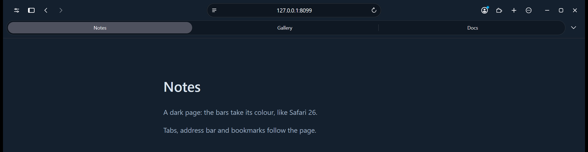
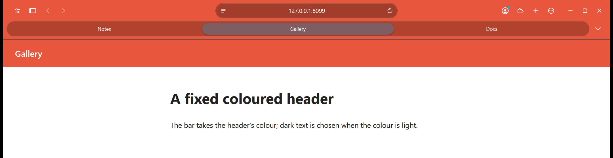
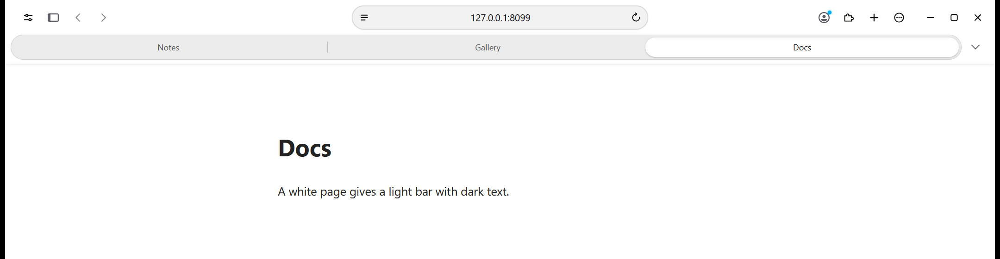
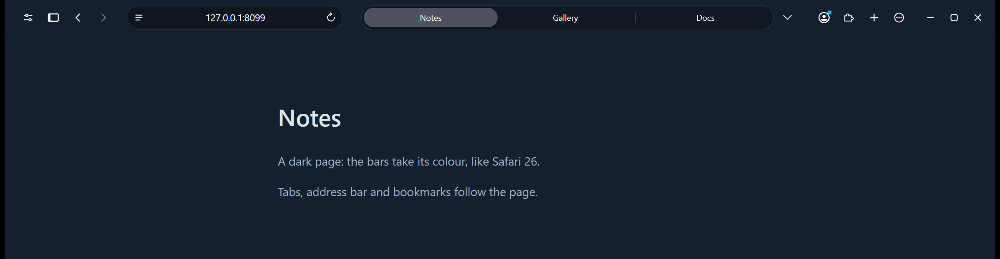
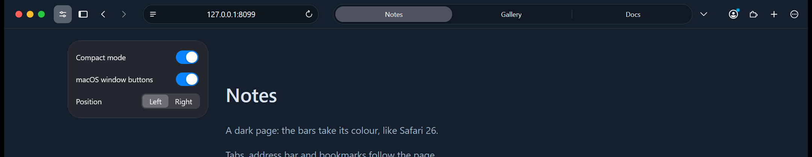
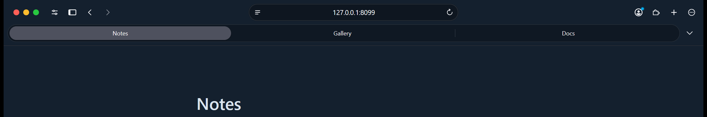
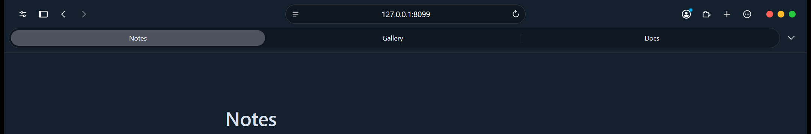
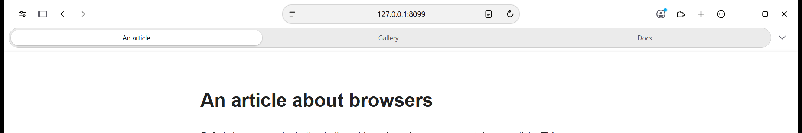

# Firefox, Safari style

A theme that makes **Firefox 159 on Windows 11** (dark mode) look like Safari on macOS: a centred address bar that only shows
the domain, capsule tabs, rounded menus and panels, thin-line icons, open / close animations, a calm New Tab page, a bar tinted
with the page's colour, a Reader button, optional macOS-style window buttons and an optional compact mode (tabs and address on
a single row).

It is made of native Firefox mechanisms only, no extension:

1. **User CSS**: `userChrome.css` (browser interface) and `userContent.css` (New Tab page, scrollbars, focus ring).
2. **An interface script**: `safari-theme.uc.js`, loaded through AutoConfig (domain only, centring, compact mode, tint).
3. **Window actors**: `tint-child.sys.mjs` / `tint-parent.sys.mjs` measure the page colour and pass it to the interface.
4. **Preferences**: `user.js`, applied at every start.

> This is an unofficial fan project. It is not affiliated with Apple or Mozilla. "Safari" is a trademark of Apple Inc.

## Screenshots

The bars take the colour of the page, and the text turns dark on a light bar:





Compact mode, tabs and address on a single row:



The Options panel (the sliders button at the left of the toolbar): Compact mode, macOS-style window buttons, and their side:



macOS-style window buttons, on the left or on the right:




The Reader button appears in the address bar on pages Firefox can show in Reader view:



## Requirements

- **Firefox 159.** This is the version the theme is checked against (every selector of the CSS exists in it, and the script, the
  page tint, the Options panel, the window buttons, the Reader button and tab groups were tested on it). 158 was checked before.
  Other versions may work, but Firefox renames interface elements from time to time; an element that stops matching simply keeps
  its normal look.
- **Windows 11 with dark mode.** Colours and icons were tuned in dark mode at 150 % display scaling.
- **Administrator rights, once**, to place a two-file loader in Firefox's installation folder. Without it the CSS still works,
  but the script (domain-only address, centring, tint, compact button) does not.

## Install

1. Download this repository (green **Code** button, then **Download ZIP**) and unzip it, or `git clone` it.
2. **Quit Firefox completely** (no `firefox.exe` left in Task Manager).
3. In PowerShell, from the repository folder:

   ```powershell
   .\install.ps1 -DryRun    # shows what would be copied, changes nothing
   .\install.ps1            # installs (asks for administrator permission for the loader)
   ```

   If PowerShell refuses to run scripts: `powershell -ExecutionPolicy Bypass -File .\install.ps1`.
4. Start Firefox.

The script finds your default profile and Firefox folder by itself. Options:

| Option | Effect |
|---|---|
| `-ProfilePath <folder>` | use this profile (find yours in `about:profiles`) |
| `-FirefoxPath <folder>` | use this Firefox installation |
| `-SkipLoader` | do not touch the installation folder (no administrator prompt; the script part will not work) |
| `-SkipUserJs` | keep your own `user.js` |
| `-DryRun` | show the actions only |
| `-Force` | continue even if Firefox is running (not recommended) |
| `-Uninstall` | remove the theme |

Files replaced in your profile are saved in `<profile>\theme-backup\<date>\`.

### Install by hand

Copy the content of `profile\` into your profile folder (`about:support`, line "Profile Folder": `user.js` and the `chrome`
folder), and the content of `loader\` into Firefox's installation folder (`config.js` and the `defaults` folder). Then restart
Firefox.

### What `user.js` changes

`user.js` is applied at every start, so it overrides the same settings in `about:preferences`. It sets:
`toolkit.legacyUserProfileCustomizations.stylesheets` (loads the CSS), `browser.download.autohideButton`,
`browser.startup.preXulSkeletonUI` (no startup mock-up), `browser.nova.enabled=false` (the CSS targets the classic Firefox UI),
`ui.systemUsesDarkTheme=1` and `browser.theme.toolbar-theme=0` (dark theme). Use `-SkipUserJs` if you manage these yourself.
Your toolbar layout is never overwritten.

## Uninstall

```powershell
.\install.ps1 -Uninstall
```

or delete `config.js` and `defaults\pref\config-prefs.js` from Firefox's folder, and the theme files from `<profile>\chrome\`
(plus `user.js` if you do not want its settings).

## Using it

- **Options menu**: the button at the left of the toolbar (sliders icon; it can be moved or removed in "Customize Toolbar")
  opens a small panel. Its "Compact mode" switch puts tabs and address on one row, like Safari's "Compact" layout. The setting is the
  preference `extensions.uc.compact`. A second switch turns the window buttons into macOS-style red / yellow / green circles, and
  a "Position" control puts them on the left or the right (preferences `extensions.uc.macButtons` and `extensions.uc.macButtonsSide`).
- **Address bar**: shows only the domain (`mail.google.com`) at rest. Click it, `Ctrl+L` or `F6` shows the full address;
  copy, reload and bookmark always use the full address.
- **Tinted bars**: the toolbar takes the colour of the page (its fixed header, otherwise its background), like Safari 26.
- **Languages**: the visible strings of the theme (Options panel, Address bar, Private Browsing) follow Firefox's language.
  To add one, add its two-letter code in the `TRANSLATIONS` table of `safari-theme.uc.js`.
- **Tuning**: spacing, durations and the address bar width are variables at the top of `userChrome.css` (`--uc-*`).

## Troubleshooting

- **Nothing changed**: Firefox must be fully closed before installing and restarted afterwards. Check `about:support`:
  "Profile Folder" must be the profile you installed into.
- **The CSS works but the address still shows the full URL / no compact button**: the loader is missing. Run the installer
  again (or `.\install.ps1` without `-SkipLoader`). A Firefox update can occasionally remove it.
- **Something looks wrong after a Firefox update**: Firefox probably renamed an element. Open an issue with your Firefox
  version and a screenshot.
- Errors from the script appear in the Browser Console (`Ctrl+Shift+J`), prefixed `safari-theme`.

## Security note

AutoConfig runs `config.js` with Firefox's full privileges, and `general.config.sandbox_enabled` is set to `false` for it. The
loader is deliberately tiny: it only loads `safari-theme.uc.js` from your profile's `chrome` folder, in browser windows.
Anyone who can write to that folder can run code in Firefox, as with any `userChrome` script. Read the files before installing.

## For developers

See [docs/DEVELOPMENT.md](docs/DEVELOPMENT.md): how the pieces work, pitfalls learned the hard way, design decisions, and how to
test in a throwaway profile (`test-tools/`).

## Credits and licence

Code under the MIT licence, see [LICENSE](LICENSE). The page-tint logic in `tint-child.sys.mjs` re-implements, in JavaScript,
the behaviour of the open-source WebKit engine (`LocalFrameView`, `PageColorSampler`; WebKit is BSD / LGPL licensed), and the
light / dark text rule follows the description in [andesco/safari-color-tinting](https://github.com/andesco/safari-color-tinting).
