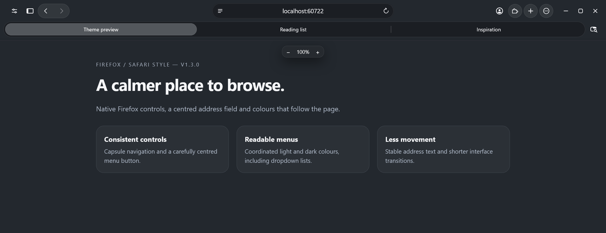
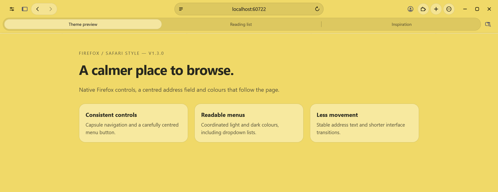
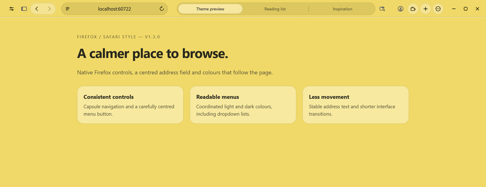

# v1.3.0 — Refined controls and readable menus

Tested with Firefox 160 on Windows 11. This update refines the Safari-style appearance while keeping the existing single-tab and bookmarks-bar behaviour.

## New and improved

- Selected tabs follow the current page tint.
- Back and Forward share a uniform capsule. An unavailable action dims only its arrow, and hovering no longer splits the background.
- Address text keeps the same bounds at rest, on focus and while typing, including the Reader slot.
- UI labels use a consistent sans-serif font.
- Menus, panels and address suggestions have coordinated light/dark palettes. Native web dropdowns stay readable with custom site colours.
- Shorter local animations; compact mode no longer adds a toolbox-height animation. Reduced motion is respected.
- The floating zoom indicator has working minus/plus buttons.
- Fixed overlapping menu-button hover surfaces and the off-centre circular icon.

## Screenshots

Captured from the final theme in an isolated Firefox 160 profile at 150% display scaling. The demonstration webpage is a preview fixture; these are real browser screenshots.

### Dark appearance

### Light appearance and page tint

### Compact layout

### Clickable zoom controls

## Validation and upgrade

Checks covered address focus/typing, real Back/Forward clicks, both menu palettes, disabled options, compact layouts, reduced motion and the single-tab row. Additional checks covered menu centring at 100%/150% and all enabled/disabled navigation combinations.

Quit Firefox completely, run `install.ps1` again, then restart Firefox. Replaced files are backed up automatically. Use `-SkipLoader -SkipUserJs` if the loader is already installed and you manage your own preferences.

Unofficial fan project; not affiliated with Apple or Mozilla.
